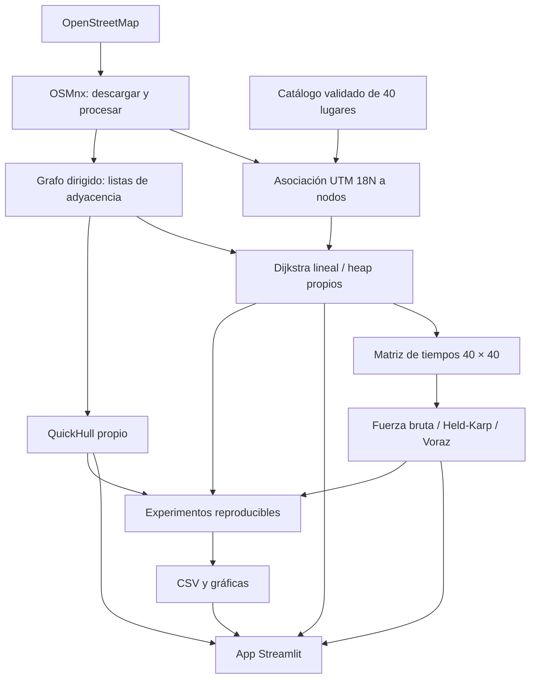

# Documento técnico (BORRADOR PARA COMPLETAR CON DATOS REALES)

**Proyecto final — Rutas del Paisaje Cultural Cafetero**

**Integrantes:** [AGREGAR] · **Curso:** Análisis de Algoritmos · **Docente:** [AGREGAR] · **Fecha:** [AGREGAR]

> Este archivo es una guía. Los datos de la demo son sintéticos y **NO deben insertarse en el informe como mediciones reales**. Completar todas las tablas y comentarios con la ejecución sobre la red del Quindío.

## 1. Arquitectura de la solución

**Entradas reales:** grafo dirigido OSM, catálogo verificado, pesos por `length` y `speed_kph`. **Salidas:** rutas en nodos, tiempos en segundos, matriz asimétrica, polígono convexo y recorridos turísticos.

## 2. R1. Modelo de la red vial (15 %)

**Problema.** Representar la red vial real del Quindío como multigrafo dirigido con sentidos de circulación y aristas de costo no negativo. Fecha de descarga: **[COMPLETAR]**. Número antes/después del filtro fuerte: **[COMPLETAR, copiar de `datos/real/resumen_red.json`]**.

**Memoria de representaciones.** Bajo los supuestos ilustrativos de 8 bytes por celda de matriz, 8 bytes por cabecera de lista y 24 bytes por entrada de arista:

- Matriz: \(8V^2 / 10^6\) MB (decimales).
- Listas: \((8V + 24E) / 10^6\) MB (decimales).

Explicar que estos son modelos de memoria, no el tamaño real de objetos de Python (que incluye encabezados y referencias). Justificar elegir listas por la dispersión vial \(E\ll V^2\).

**Pesos.** Con longitud en metros y velocidad en km/h: \(t_{s} = 3.6\, L_{m}/v_{km/h}\). En `rutas/procesamiento.py` se usa `ox.routing.add_edge_speeds` y `add_edge_travel_times`; `maxspeed` cuando está disponible y, en ausencia, velocidad supuesta según tipo de carretera. Son **tiempos de flujo libre estimados**, no velocidades observadas ni tráfico real. Adjuntar tabla de parámetros y fuente/metodología.

**Componente fuertemente conexa.** `ox.truncate.largest_component(G, strongly=True)` se apoya en `nx.strongly_connected_components` cuando la red no está ya fuertemente conectada. El algoritmo subyacente es de la familia de Tarjan (ver versión exacta del código de NetworkX instalada); su complejidad asintótica es \(O(V+E)\) en tiempo, con memoria adicional \(O(V)\) para el DFS, además del almacenamiento de la red. Comprobar la implementación **de la versión instalada** mediante la referencia al código. La fuerte conexión asegura rutas dirigidas entre todos los nodos retenidos.

**Tabla obligatoria 1:** nodos/aristas antes y después. **Tabla obligatoria 2:** radios 2,5,10,20 km y departamento; columnas `red`, `V`, `E`, `V+E`, `tiempo_ms` de `r1_componentes.csv`. Comentario: **[COMPLETAR de acuerdo con las medidas]**.

**Asociación geográfica.** Transformar WGS84 → UTM zona 18N (EPSG:32618), distancia euclidiana en metros al nodo más cercano de la componente. Listar y justificar alertas de más de 500 m desde `alertas_nodos_lejanos.json`.

## 3. R2. Caminos mínimos (20 %)

**Algoritmos propios:**

- Lineal: encontrar el nodo con menor distancia provisional mediante búsqueda sobre no visitados. Selección cuesta \(O(V)\) cada vez: \(T(V,E)=O(V^2+E)=O(V^2)\) en grafo simple. Memoria auxiliar \(O(V)\), además del grafo.
- Heap: `heapq` almacena parejas `(distancia, nodo)` con posibles entradas obsoletas; al extraer se ignoran duplicados. \(O((V+E)\log V)\) tiempo; \(O(V+E)\) memoria auxiliar en implementación con inserciones repetidas.

**Invariante de correctitud.** Cuando un nodo \(u\) se extrae por primera vez con la menor distancia tentativa, su etiqueta coincide con el costo del camino más corto desde el origen. Con pesos de arista no negativos, ningún camino a través de vértices aún no asentados puede mejorarlo. Por eso **se permite detenerse al EXTRAER el destino**, no cuando se descubre por primera vez. En la versión lineal se detiene al seleccionarlo como mínimo.

**Experimentos.** 20 pares para heap, 10 de ellos cercanos también para lineal; verificar costos idénticos, contar solo asentamientos (nodo explorado una sola vez), graficar nodos explorados frente a tiempo en ms, calcular cociente lineal/heap: mediana, mínimo y máximo. Fuentes de datos `r2_dijkstra.csv`, `r2_cocientes.json`, `r2_dijkstra.png`.

**Matriz 40×40.** Dijkstra con heap se ejecuta **una vez por origen**, sin destino para recorrer toda la componente. Registrar el tiempo en segundos, y explicar la asimetría debida a sentidos y costos de vías. `datos/real/matriz_tiempos.csv`.

**Resultados/discusión:** [COMPLETAR: tendencias de escalamiento, diferencias y hardware].

## 4. R3. Envolvente convexa (20 %)

**Algoritmo:** QuickHull **implementado desde cero con divide y vencerás**. Se seleccionan dos extremos, se separan puntos a cada lado de la recta, se escoge el más alejado en cada subproblema, se subdivide recursivamente y se concatenan vértices en orden. Producto cruzado sobre coordenadas enteras redondeadas a metros; colineales intermedios no forman vértices.

**Recurrencia:** \(T(n)=T(n_1)+T(n_2)+cn\), según los tamaños de subconjuntos que quedan en cada llamada. Con particiones favorables la profundidad tiende a logarítmica y el tiempo esperado típico es \(O(n\log n)\); para casos adversos, \(O(n^2)\). Discutir la distribución de puntos viales (tendencia a ser espacialmente no uniforme), el costo de crear listas por niveles y la memoria (datos, listas auxiliares, recursión).

**Comprobación:** `scipy.spatial.ConvexHull` devuelve los mismos vértices (comparar como conjuntos, no por índice inicial). SciPy envuelve **Qhull**, una implementación nativa eficiente; no se llama a SciPy dentro de QuickHull. Datos: nodos reales y 1.000, 10.000, 50.000 puntos aleatorios uniformes dentro de un cuadrado (semilla 2026). La matriz NumPy se crea fuera del temporizador.

**Tabla:** `r3_envolvente.csv`, gráfica `r3_envolvente.png`. Discusión **[COMPLETAR]** incluyendo diferencias Python frente a código compilado y variaciones por datos.

## 5. R4. Ruta óptima (25 %)

**Formulación.** El costo de ruta se obtiene de la matriz dirigida \(d(i,j)\) construida en R2. El objetivo es salir de `M01` (Armenia), recorrer \(k\) lugares distintos y volver a `M01` minimizando el tiempo de desplazamiento. Es un TSP **asimétrico**.

**Fuerza bruta.** Enumera \(k!\) permutaciones, calcula \(k+1\) arcos por cada una; tiempo \(O(k\,k!)\) y espacio auxiliar \(O(k)\) (sin materializar todas las permutaciones).

**Held-Karp por subconjuntos.** Sea \(D(S,j)\) el costo mínimo desde inicio visitando exactamente \(S\) y terminando en \(j\):

- Base \(D(\{j\},j)=d(inicio,j)\).
- Recurrencia \(D(S,j)=\min_{i\in S\setminus\{j\}} [D(S\setminus\{j\},i)+d(i,j)]\).
- Final \(\min_j [D(Todos,j)+d(j,inicio)]\).

La subestructura óptima se justifica porque el prefijo de un recorrido óptimo también debe ser óptimo dado **su subconjunto visitado y su último nodo**: si hubiera un prefijo mejor, se reemplazaría sin afectar las visitas restantes y se mejoraría el tour, contradicción. Almacenar también el último predecesor permite **reconstruir el orden**, no solo el costo. Tiempo \(O(k^2 2^k)\), memoria \(O(k 2^k)\). En código `dp[(mascara,ultimo)]` y `anterior[(mascara,ultimo)]`.

**Heurística:** vecino más cercano. Desde el nodo actual se selecciona el destino no visitado con menor tiempo, y al terminar se vuelve al origen. Tiempo \(O(k^2)\) y memoria \(O(k)\). No tiene garantía global: una decisión local temprana puede forzar un arco muy caro posteriormente. En cambio, Dijkstra sí es óptimo con pesos no negativos por su invariante global sobre el nodo de menor etiqueta tentativa.

**Ejemplo explicativo del fallo voraz:** Matriz ficticia dirigida: \(d(A,B)=1,d(A,C)=2,d(B,C)=100,d(B,A)=1,d(C,B)=1,d(C,A)=2\). El vecino más cercano escoge \(A\to B\to C\to A=103\), aunque \(A\to C\to B\to A=4\). No son tiempos reales del Quindío; es una prueba controlada.

**Experimento exacto:** Aumentar \(k=5\) hasta \(12\), o hasta el límite de cinco minutos si ocurre antes; comparar costos y graficar tiempos, registrar mayor k resuelto. `r4_exactos.csv` y `r4_exactos.png`. **Calidad heurística:** \(k=5,8,10,12\), al menos 5 instancias por k con semilla fija y porcentaje de brecha \(100(costo_{voraz}/costo_{óptimo}-1)\); `r4_calidad.csv`.

**Itinerario de 11 horas:** elegir 6-8 atractivos y ordenar con Held-Karp. Sumar viajes y visitas; si excede 11 h, retirar atractivos con justificación, recalcular. `r4_itinerario.csv`, `r4_itinerario_resumen.json`. El script retira el atractivo que aporta el mayor ahorro marginal estimado (visita más detour sustituido) y recalcula; verificar manualmente si el itinerario final es turísticamente razonable.

**Resultados y discusión:** [COMPLETAR con CSV reales y la diferencia porcentual].

## 6. R5. Aplicación (5 %)

**Tecnología:** Python + Streamlit + Folium. Posibilita consultar caminos mínimos y trazarlos sobre la geometría de vías; dibuja la envolvente convexa; calcula itinerarios de 6-8 atractivos con Held-Karp y vecino cercano en el momento; expone tablas y gráficas de experimentos. Se inicia con `python -m streamlit run app.py`. La visualización es demostrativa; no requiere servidor de producción.

## 7. Metodología experimental y reproducibilidad

- **Procesador:** [COMPLETAR] · **RAM:** [COMPLETAR] · **SO:** [COMPLETAR] · **Python/OSMnx/NetworkX/SciPy:** [COMPLETAR].
- Semilla `2026` y medición en ms con `time.perf_counter_ns`.
- Cinco ejecuciones por instancia, mediana; si tarda más de un minuto, una ejecución. Más de cinco minutos: «no completada».
- Se excluyen acceso a disco, generación de datos e impresión. Se comparan algoritmos **en la misma máquina**.
- Pruebas con casos pequeños, adversos y comparación con oráculos **solo en tests**.
- Resultados leídos de CSV/JSON, gráficas reproducibles.

## 8. Conclusiones

[REDACTAR tras las mediciones REALES: comparar estructuras y algoritmos con hipótesis, límites y trade-offs].

## 9. Anexo. Uso de inteligencia artificial

**Herramientas utilizadas:** ChatGPT (OpenAI) **[confirmar o modificar herramientas realmente utilizadas]**.

**Para qué:** apoyo en arquitectura, borradores de código, especificaciones, pruebas y documentación. **Cómo se verificó:** tests de Dijkstra con NetworkX como oráculo, de QuickHull con SciPy, de Held-Karp con fuerza bruta, mediciones repetidas, revisión de código por cada integrante. **Modificaciones/validación humana:** [COMPLETAR con actividades reales].

## 10. Fuentes y bibliografía inicial

- Enunciado del profesor: *Proyecto final 2026-2, Rutas del Paisaje Cultural Cafetero* y *Anexo. Formato de los resultados*.
- Diapositivas del curso: *Tiempo de ejecución*, *Complejidad computacional*, *Algoritmos recursivos*, *Búsquedas y ordenamiento*, *Divide y vencerás*, *Algoritmos voraces*, *Programación dinámica*.
- Documentación OSMnx, `graph_from_place`, `truncate.largest_component`, `routing.add_edge_speeds`, `routing.add_edge_travel_times`: https://osmnx.readthedocs.io/en/stable/user-reference.html
- Código de `largest_component`: https://github.com/gboeing/osmnx/blob/main/osmnx/truncate.py
- NetworkX SCC, ver versión instalada: https://networkx.org/documentation/stable/reference/algorithms/generated/networkx.algorithms.components.strongly_connected_components.html
- SciPy ConvexHull/Qhull: https://docs.scipy.org/doc/scipy/reference/generated/scipy.spatial.ConvexHull.html
- Referencia matemática de TSP y programación dinámica: diapositivas 09 del curso.
- **[AGREGAR referencias del catálogo, velocidades asumidas, diseño de QuickHull y complejidades]**.
